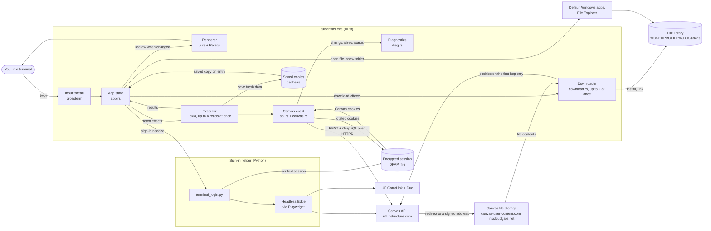
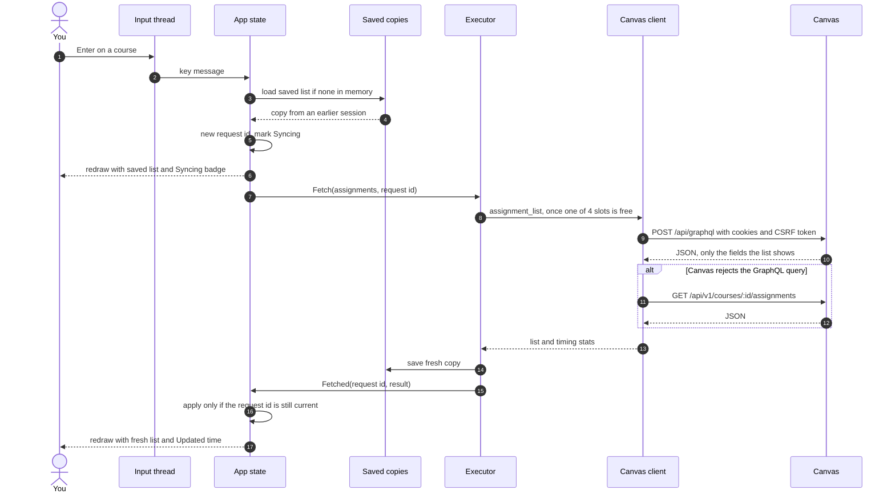
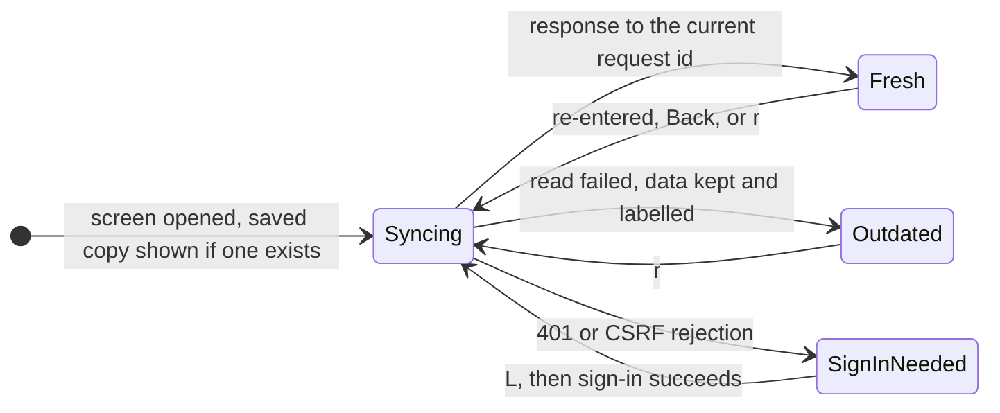
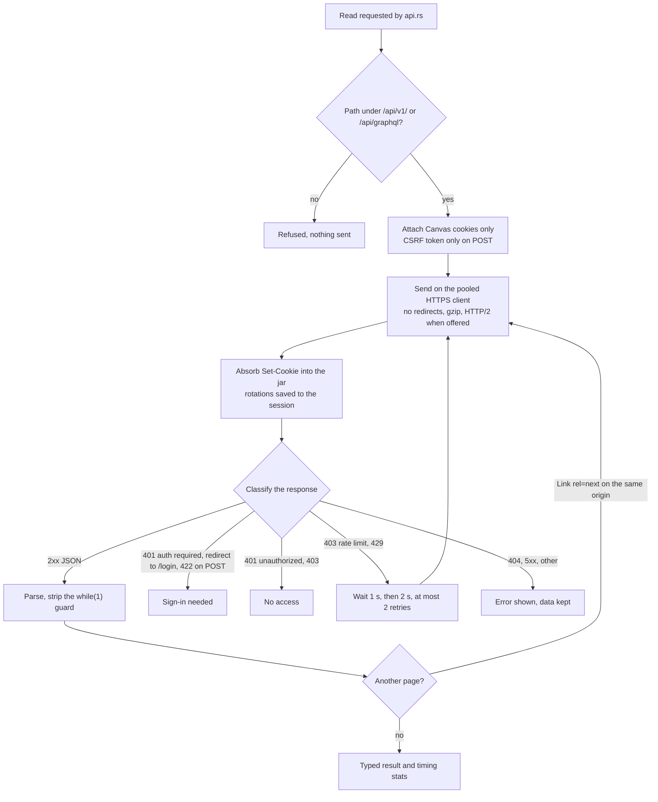
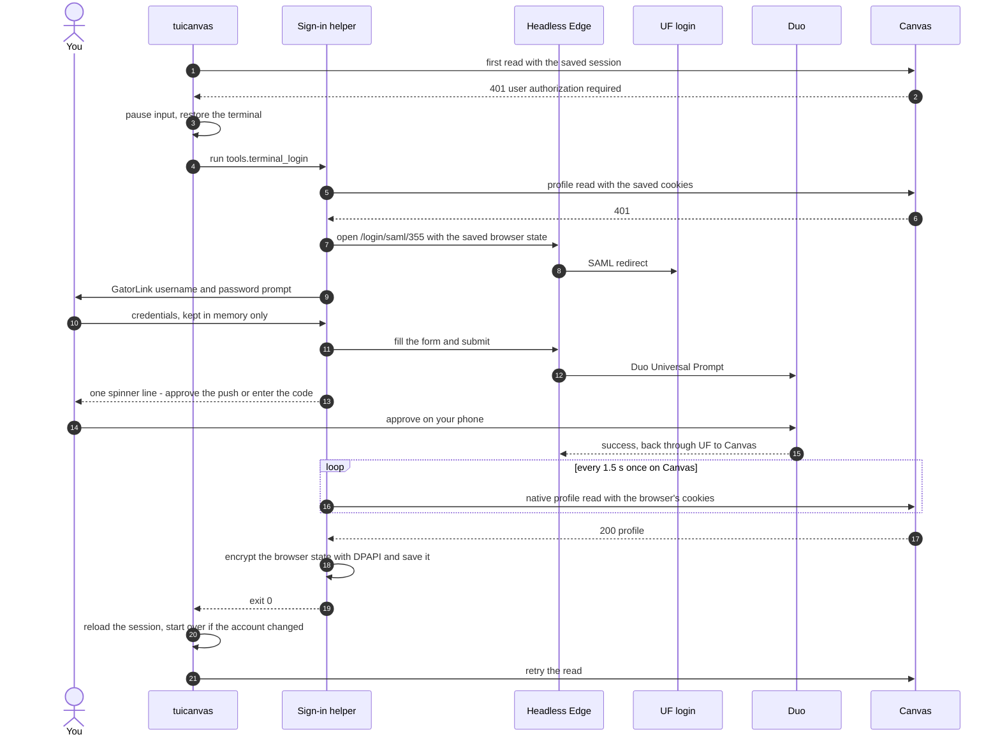
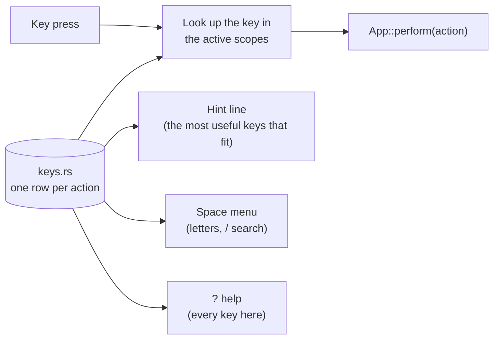
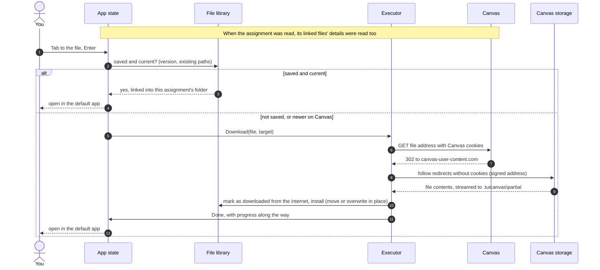

# Architecture

How TUICanvas works today: the pieces, how a screen gets its data, how sign-in works, and which optimizations are in place. Progress and next steps are tracked separately in [status.md](status.md); every network read is justified in [request-policy.md](request-policy.md).

TUICanvas has two programs:

- **`tuicanvas.exe` (Rust).** The reader you use. It draws the terminal UI and makes read-only Canvas API calls directly over HTTPS. It never loads the Canvas web app. It also downloads course files into a folder on your PC (the file library) and opens them in their default apps.
- **The sign-in helper (Python, `tools/terminal_login.py`).** It runs only when a session is missing or expired. It drives UF's normal GatorLink + Duo login in a hidden Microsoft Edge window from the terminal, checks the result, and saves the session for the reader.

The two share one file: the session, encrypted with Windows DPAPI at `%LOCALAPPDATA%\TUICanvas\ufl.session.dpapi`.

The course list also has a local edit mode. Its hidden course IDs are kept in the origin and account scoped snapshot directory, separate from Canvas course data. A Canvas refresh cannot reset the user's home screen choices; editing adds no network reads.

## Overview



## Components

| Piece | File(s) | Responsibility |
| --- | --- | --- |
| Entry point | `src/main.rs` | Command-line options: reader, `--login`, `--logout`, `--diag`, `--smoke`, `--dump` |
| Configuration | `src/config.rs` | Canvas origin (default `https://ufl.instructure.com`, override with `TUICANVAS_ORIGIN`); data, session and cache paths; finding the sign-in helper |
| Session | `src/session.rs`, `src/protect.rs` | Decrypt and encrypt the shared session with DPAPI, preserving every field the helper wrote. A small cookie jar matches domain, path and expiry, and absorbs `Set-Cookie` rotations. It also extracts the CSRF token. |
| Transport | `src/transport.rs` | One pooled `reqwest` client: HTTPS only, no redirects, timeouts, gzip, HTTP/2 when the server offers it, 16 MB response cap. Behind a trait so tests use a scripted fake. |
| Canvas client | `src/canvas.rs` | Allowlisted paths, cookies and CSRF, error classification, throttling back-off, pagination, GraphQL error handling |
| Reads | `src/api.rs` | The reviewed read operations: courses (REST), assignment list (GraphQL with REST fallback), assignment detail (REST), a course's folders and files (REST), one file's details (REST), profile |
| Model | `src/model.rs` | Typed courses, assignments, submissions, files and folders; the status shown for each assignment (Missing, Submitted late, Graded 9/10, …) |
| File library | `src/library.rs` | The folder tree under `%USERPROFILE%\TUICanvas`, Windows-safe names, one stored copy per Canvas file shown in several places through hard links, an index of versions and last use, and the 30-day clean-up of automatic image downloads |
| Downloads | `src/download.rs` | Follows Canvas's redirects by hand: cookies only to the Canvas origin, then only to Canvas's two storage domains over HTTPS. Streams to a partial file, checks the length, 2 GB cap. |
| Saved copies | `src/cache.rs` | Versioned JSON snapshots per Canvas origin and account, written atomically |
| Keyboard | `src/keys.rs` | Every action declared once: its keys, the screens it applies to, its hint-line label and its letter in the actions menu. Key handling, the hint line, the `?` help screen and the `Space` menu are all generated from it. |
| App state | `src/app.rs` | Pure state machine. Messages in (keys, fetch results, download progress, ticks); effects out (fetch, download, open a file, show a folder, open URL, sign in). Owns navigation, filtering, freshness rules and where each file goes. |
| Runtime | `src/tui.rs` | Terminal setup and restore, input thread, async executor and download slots, sign-in handoff, opening files and folders, headless `--dump` mode |
| Rendering | `src/ui.rs`, `src/theme.rs`, `src/html.rs` | Screens, the Assignments/Files tabs, the files & links list, colours, description HTML to terminal text with links numbered to match the list |
| Inline images | `src/images.rs` | Terminal capability detection, reading an image out of the library, fitting it to a box of text cells, and drawing it as half blocks |
| Diagnostics | `src/diag.rs` | Endpoint templates, status, bytes and timings; optional JSONL log. Never URLs with ids, headers or bodies. |
| Live check | `src/smoke.rs` | Read-only verification against Canvas that writes a metadata-only report |
| Sign-in helper | `tools/terminal_login.py`, `tools/auth_ui.py`, `tools/auth_session.py` | Browser-driven login, the one-line status display, DPAPI save, native verification |

## Reading a screen

Every screen follows the same pattern. Show what is already known immediately, start one fresh read, and replace the screen only with the result of the latest read. This example opens a course's assignment list:



Network calls and JSON parsing run on Tokio worker threads; the UI thread only updates state and draws. The one exception is reading a saved copy, a small local JSON file read on the UI thread when a screen opens.

## Freshness rules

These follow the rules approved in the build plan. A saved copy may be shown, but every visit still triggers a fresh read, and nothing pretends to be current when it isn't.



- **Every access reads again.** Opening a screen, going Back to it, or pressing `r` starts a new read.
- **Two-second reuse.** If an equivalent read started less than 2 seconds ago is still in flight, it satisfies the new access instead of being duplicated. An older in-flight read does not.
- **Latest wins.** Each read carries a request id, and a response is applied only if its id is still the newest for that resource. A slow older response can never overwrite newer data.
- **Failures never hide.** A failed read leaves the previous data on screen, marked **Outdated** with the reason.
- **One exception: course tabs.** Which tabs a course shows changes rarely, so the saved list is used at once and read from Canvas once per run and on `r`, not on every visit.
- **Sign-in.**
  - An expired session found at startup opens sign-in directly.
  - One that expires mid-session shows a banner and waits for `L`.
  - Lacking access to one item ("no access", "not found") never triggers a sign-in.

## The request path



GraphQL responses that contain any `errors` entry fail the whole read, so a partial response never replaces good data. A list with a failed page also fails as a whole rather than appearing complete.

## Signing in



Details that matter:

- **Credentials.** They exist only in the helper's memory long enough to fill UF's form. They are never logged or saved, and never sent anywhere except UF's login page.
- **Which pages are trusted.**
  - The helper only follows pages on UF's login host, Duo, and Canvas.
  - Known Duo screens (push, Verified Push code, "Is this your device?") are shown as one status line.
  - Unknown challenges are shown in full with their real options rather than guessed at.
  - Canvas pages are never presented as prompts.
  - A page read is thrown away if the browser moved on while it was being read.
- **Completion is checked natively.** The helper confirms sign-in with a direct API read, not by looking for something on the Canvas page, because Canvas changes its pages.
- **What gets saved.** The whole Playwright storage state, so UF and Duo cookies survive for the next browser login. The reader only ever sends cookies that belong to Canvas.

## Keyboard

All keys are declared in one table, `src/keys.rs`. Each row names an action, its keys, the scopes it applies in (for example the course list, a list inside a course, a page, the focused files & links section, a text box), a short hint label, a title, and optionally a letter in the actions menu.



- **One meaning per key.** `↑↓` move, `Enter` open, `Esc` back, `Tab` next tab or section, `/` search, `r` refresh, `o` browser, `Space` actions, `?` help and `q` quit mean the same wherever they work. Text boxes are the exception: letters are text there, and `Tab` completes a path.
- **The actions menu** lists what applies to the selection and the screen, grouped, each with the letter that runs it; `/` searches it. Rare actions (hide a course, show hidden courses, open the TUICanvas folder, sign in again) are only in the menu, so they take no key of their own.
- **Pages have sections, not modes.** An assignment or announcement is one scrolling page: details, text, files & links, and (assignments) past submissions. `Tab` moves the focus between sections; `↑↓` then act on the focused one; `Esc` returns to the text.
- **Checked by tests.** No key may do two things in one place; core keys may not change meaning; menu letters are unique on every screen; every action can be triggered; the hint line fits 80 columns and always ends with `Space actions` and `? help`.

## Files and the local library

Course files live in an ordinary folder you can browse in File Explorer:

```text
C:\Users\<you>\TUICanvas\
├── EEL5934 Introduction to GPU Computing\
│   ├── Class Files\              the course's Files area, same folders as Canvas
│   │   └── Slides\mod-1-intro-accessible.pdf
│   └── Assignment Files\
│       └── Lab-2 Assignment\     attachments and images of that assignment
└── .tuicanvas\                   index (versions, paths, last use) and partial downloads
```

- **Where you find files.** Each course has tabs for **Assignments**, **Files** and **Announcements** (`Tab` switches). Files shows the course's folders as Canvas has them; one listing read covers the whole course, so moving between folders and searching (`/`, across all folders) needs no further reads. Each assignment has a **Files & links** list under its description, numbered like the links in the text.
- **When files download.**
  - When you open one (`Enter`, then it opens in its default app), or ask for it (`d`, or `D` for everything in a folder or assignment).
  - Images in an assignment's description download automatically when the assignment is read, so they open instantly later. They are removed after a week without use, unless you opened or downloaded them yourself.
- **One copy, several places.** A file that is both in Class Files and attached to an assignment is stored once and appears in both folders through an NTFS hard link (a second name for the same data). If linking is impossible, it is copied, and both copies are tracked.
- **Keeping files current.** The index records each file's Canvas version (modified time and size). When Canvas has a newer version, the file shows **newer on Canvas**; downloading it again overwrites the stored copy in place, which updates every place it appears.
- **Names.** Windows-safe (reserved characters and names replaced, length capped, extension kept). Two different files that want the same name in one folder get `name (file id).ext`; a file the reader did not put there is never replaced.
- **Locked and hidden files.** A file Canvas marks as locked is not downloaded; its reason is shown. When an instructor hides a course's Files area (8 of 17 courses here), the Files tab says so, and files linked from assignments still work.

Opening a file linked from an assignment:



- **Opening.** Files open in their default Windows app. Programs and scripts (`.exe`, `.bat`, `.ps1`, `.lnk` and similar) are never opened: they are shown selected in File Explorer instead. Downloaded files carry the same "downloaded from the internet" mark that browsers add, so Office opens them in Protected View and Windows checks programs with SmartScreen.
- **Links.** Other assignments open in the reader. Canvas pages, modules, discussions and tools open in the browser (out of scope for the reader for now), as do outside sites and email links.

## Rendering

- **Event-driven.** The screen redraws only when state changed (a key, a result, a resize). With nothing loading, the main loop blocks on its message channel and uses no CPU. While the current screen syncs, a 150 ms tick animates the badge.
- **Coalesced.** All messages waiting in the channel are applied before drawing once.
- **Visible rows only.** Lists build table rows just for the visible window around the selection, however long the list is.
- **Descriptions are converted once.** Assignment HTML becomes wrapped terminal text once per assignment version and terminal width. Scrolling reuses that text and styles only the lines on screen.
- **Untrusted text is cleaned.** Escape sequences, control characters and bidirectional overrides are removed from everything Canvas returns before it reaches the terminal.

## Optimizations in place

| Optimization | Where | Effect (measured where noted) |
| --- | --- | --- |
| Skip the web app entirely | whole design | Measured ([baseline](../benchmarks/baseline-2026-10-20.md)): fresh content in 0.27–0.33 s per step vs 2.1–2.7 s on the website, with 1 request (2–21 KB) per screen instead of 130–190 requests |
| Field-selected GraphQL for assignment lists | `api.rs` | Across 17 courses: 64–75 KB instead of 944 KB, median ≈300 ms instead of ≈600 ms per course, worst case 1.9 s instead of 9.6 s. Verified identical data on all 157 assignments. |
| REST kept where GraphQL gains little | `api.rs` | A minimal GraphQL detail query saved 30–70 ms (median 183 ms vs 213–252 ms on a 4 KB response), so the documented REST read stays |
| Saved copy shown instantly, then refreshed | `app.rs`, `cache.rs` | Revisited screens appear with no network wait; freshness still guaranteed by the re-read |
| Reuse of a just-started read | `app.rs` | Quick back-and-forth within 2 s does not issue duplicate requests |
| Latest-request-wins | `app.rs` | No wasted redraws or wrong data from slow, superseded responses |
| One pooled HTTPS client | `transport.rs` | Connections (TLS handshakes) are reused across screens; gzip; HTTP/2 negotiated when offered |
| Largest page size | `api.rs` | `per_page=100` and `first: 100`: every course list and assignment list so far fits in one request |
| Bounded concurrency | `tui.rs` | At most 4 reads at once, so the reader never floods Canvas |
| Throttling back-off | `canvas.rs` | Honors Canvas rate limiting (1 s, then 2 s) instead of failing or hammering |
| Off-thread network and parsing | `tui.rs` | Keys stay responsive while reads are in flight |
| Event-driven, coalesced redraws | `tui.rs` | Zero CPU when idle; one draw per batch of changes |
| Visible-rows-only tables | `ui.rs` | Drawing cost does not grow with list length |
| Description converted once per width | `ui.rs`, `html.rs` | Scrolling never re-parses HTML |
| Search palette | `search.rs`, `app.rs` | `/` or `Ctrl+K` searches everything already read, without any request. Matching is a subsequence maximised by a small dynamic program, so each character is placed where the whole query scores best rather than where it first fits; adjacency pays more than a word start, or three scattered word starts would beat the literal word. A title match always outranks one that only matched the course a thing sits in, and a context match must contain the query as text, because scattered letters are findable in almost any long context. |
| Search warm-up | `app.rs` | The lists the palette needs, queued when the course list arrives and read two at a time so the screen in front of the user keeps half the executor's capacity. Once per run, nothing re-read, off unless a person is driving. |
| Session reuse and cookie rotation | `session.rs`, `tui.rs` | No browser and no Duo while the session is valid; rotated cookies are saved back |
| Native sign-in check | `terminal_login.py` | Sign-in finishes as soon as Canvas accepts the session, without waiting on page elements |
| One listing per course's Files | `api.rs`, `app.rs` | The folders and files reads run together (about 300 ms for 2 requests here); moving between folders and searching need no request |
| No download while the saved copy is current | `app.rs`, `library.rs` | A saved, current file opens straight from disk; the comparison uses the index, not a request |
| One stored copy per file | `library.rs` | Hard links: a file in several places takes its space once, and one re-download updates all of them |
| Separate download slots | `tui.rs` | At most 2 downloads at once, apart from the 4 read slots, so a large download never delays a screen |
| Streamed downloads | `download.rs`, `tui.rs` | Written to disk as they arrive; progress reported at most every 120 ms. Measured: a 908 KB PDF in 1.1 s, including the redirects. |
| Images fetched with the assignment | `app.rs` | Opening an image later needs no wait |
| Release build tuning | `Cargo.toml` | Thin LTO; debug info stripped |

Sizes are of the decompressed JSON bodies. Timings come from `tuicanvas --smoke` runs on one account and home connection (see [request-policy.md](request-policy.md)).

## Not applied yet

- **Prediction / prefetch** (Milestone 5): fetching an assignment's detail after its row stays selected for about 150 ms. The approved 2-second freshness rule is already in place for it to use.
- **Conditional requests** (`If-None-Match`): Canvas sends validators, but whether it honours them for these reads, and saves anything, is unmeasured.
- **Longer-lived caching** of resources that rarely change (for example, the course list) without re-reading on entry. This needs a per-resource decision (Milestone 4).
- **Rust-native sign-in,** which would remove the Python, Playwright and Edge dependency.

## Safety properties

- **Read only.** The only POST is the reviewed GraphQL list query; nothing writes to Canvas. Downloads are reads.
- **Allowlisted paths.** Requests go only to `/api/v1/` and `/api/graphql` on the configured origin. Pagination links must stay on that origin and path. IDs are validated before they go into a URL.
- **Cookies stay scoped.** Identity-provider cookies are never sent to Canvas, and the CSRF token is sent only on POST. Downloads send Canvas cookies only to the Canvas origin; the redirects after that go only to Canvas's two storage domains, over HTTPS, without cookies.
- **What opens outside the reader.** Pages for courses, assignments and files are built on the configured Canvas origin. Links in descriptions open like a click in the browser would, limited to `https`, `http` and `mailto`. Downloaded programs and scripts are never run.
- **Per-account copies.** Saved copies are separated by Canvas origin and account; `--logout` deletes the session and that account's copies.
- **No content in diagnostics.** Diagnostics, smoke reports and the helper's report contain statuses, sizes and timings only. Raw captures and reports stay in git-ignored folders.

## Development tooling

| Tool | Use |
| --- | --- |
| `cargo test`, `python -m unittest tools.test_*` | Unit tests with a scripted transport, synthetic sessions and replayed Duo screens; no network, credentials or MFA |
| `tuicanvas --smoke` | Live read-only verification and measurement → `benchmarks/private/smoke.json`. Includes a course's Files listing, access to every file linked from its assignments, and one download into a scratch library with a hard-link check. |
| `tuicanvas --dump DIR` | Walks courses → course → assignment → Files tab → a folder headlessly, downloads the smallest file there into a scratch library through the same path the reader uses, and writes each rendered screen as text, with render and sync timings |
| `tuicanvas --diag` | Logs every request (template, status, size, timing) and every frame to `%LOCALAPPDATA%\TUICanvas\diagnostics.jsonl`. Frames: startup to first frame, each key to its frame, and each read from the action that caused it to the frame showing its data, split into network, parse and response-to-frame. Also logs CPU and peak memory at exit. |
| `tuicanvas --bench N` | Runs start → course list → course → assignment → back N times, cold and warm, on an in-memory screen (or `--terminal` for a real console). Uses a private snapshot folder. Writes `benchmarks/private/tui-bench*.json`. |
| `tools/browser_bench.py` | The same workflow on the Canvas website in headless Edge with the saved session. Content-visible time is taken from the page's own clock; requests and transferred bytes are counted with DevTools Protocol events. Writes `benchmarks/private/browser-bench.json`. |
| `scripts/check.ps1`, `scripts/watch.ps1` | Build, test, live checks and git tasks on Windows, on request |

## Announcements

`announcements.rs` owns the typed list/detail models and request policy. It fetches the selected course's metadata using paginated GraphQL, then sorts by posting time (delayed/creation dates as fallbacks); a single REST read loads an opened announcement's body and attachments. A schema rejection permits the REST list fallback, while network/auth/pagination failures remain visible.

The tab and detail use distinct `ResourceKey` variants, so snapshots, request generations, Syncing/Outdated states and rendering caches stay separate from assignments. Only visible list rows are rendered, and message HTML is wrapped once per version and width. Links share the existing Canvas file library and assignment navigation; file metadata and downloads are requested only when a file is chosen. Announcement read status combines Canvas state with account-scoped local reading history. Opening a readable detail records its course/topic ID separately from snapshots; fresh server responses cannot erase this local Read indicator. No read-status writes are sent to Canvas.

## Course tabs, modules and pages

`modules.rs` reads three things. `/api/v1/courses/:id/tabs` lists the tabs Canvas shows the student; hidden tabs are left out by Canvas (and any marked hidden are dropped), so the reader shows a course section only when its tab is listed. The course's `default_view` (its Canvas home) decides what the Home tab shows: a page home becomes the **Home** tab (the front page, read from `/api/v1/courses/:id/front_page` under the reserved name `.front`, which no real page name can have), and a Modules or Assignments home shows that section first even with its tab hidden, as Canvas does. Home is both a course tab and a page, so it uses the `CourseTabs` key scope instead of `Sections`: `Tab` switches tabs there, and `1`–`9` reach its links. `App::course_tabs` turns this into the sections in Canvas's order; before the tabs are known (first visit, no saved copy) all four are offered and the view moves to the first shown one when the read arrives. When a read finds the current section hidden, the view is replaced by the first shown section, or by a course screen saying nothing is shown.

`/api/v1/courses/:id/modules?include[]=items&include[]=content_details` returns modules with their items; a module whose items Canvas leaves out is read separately. The Modules screen is one flat list of module headings and items (`ModuleRow`); headings are not selectable. Item ids, content ids and page URL names are validated before they are put into a request path or file name (`valid_slug`). `/api/v1/courses/:id/pages/:url` reads one page; its key, snapshot and render cache are separate, and page links in any HTML (`/courses/:id/pages/:url`) classify as `Target::Page` and open in the reader.

The Pages tab is the page list (`/api/v1/courses/:id/pages`, newest change first), with its own key and saved copy; `Enter` opens a page through the same page read and render cache as a page reached from a module or a link, so nothing about reading a page is duplicated.

## Grades

`grades.rs` reads a course's grades in three requests: the assignment groups with their weights and the student's own submissions, the course itself for the total, and one multi-assignment submission read for the instructor comments. They are one `Resource` under one key (`ResourceKey::Grades`), saved and shown at once like every other screen. The Grades screen is a flat list of group headings and assignments (`GradeRow`), with headings not selectable, as Modules does; `Enter` opens the assignment in the reader and `o` opens it on Canvas.

Three things Canvas does are reflected deliberately. The course total is absent, not zero, where the instructor hides final grades, and the screen says so. A group's own points leave out excused work and anything the instructor omits from the final grade, which is how Canvas computes it. The comment read is the only one allowed to fail quietly: it is what puts a mark on rows with instructor comments, and a course that refuses it (403) still shows its grades. An expired session is never mistaken for hidden comments.

Which assignments' comments have been seen is local to this machine (`local-seen-feedback.json`, beside the announcement reads) and Canvas is never told. Opening an assignment from the Grades tab is what clears its mark. The course list can show every course's current grade (`Space` then `g`), one switch for all of them, saved in `local-show-course-grades.json`; turning it on reads the grades of the courses on screen.

A module file is placed after a fresh read of its details. When Files is shown the course's folder list is read too (or its saved copy used) so the file lands in `Class Files` under its Canvas folder; when Files is hidden the folder read would fail with 403, so the file goes to `Module Files/<module>`. Nothing is written to Canvas: module progress is not marked from the reader.

## Images in the terminal

Images embedded in assignment, page and announcement text are drawn where the
text has them. `images.rs` owns all of it; `ui.rs` calls it once where it wraps
the text and once where it draws a body line.

- **The file is already there.** `html.rs` turns each `` into an
  `[image: alt][n]` mark, where `n` is the image's place in the page's files &
  links list, and opening a page already downloads its images into the library
  (removed after a week unused, see **Files and the local library**). This
  module only reads the local copy. It never requests anything.
- **Half blocks.** A cell is drawn as the upper half block `▀` with the top
  pixel as its foreground colour and the bottom pixel as its background, so one
  cell carries two pixels and a row of cells is two pixel rows. That needs only
  truecolor, which every terminal the reader targets has, and it looks
  deliberately low-resolution.
- **A bounded box.** `fit` gives an image of `w` by `h` pixels a box of at most
  72 cells across and 20 down, inside the page's text width, keeping the aspect
  ratio (a cell counts as one pixel wide and two tall) and never enlarging past
  one pixel per half cell.
- **The scroll arithmetic is unchanged.** The box's rows are inserted into the
  body as ordinary blank text lines, with a map from line index to the cells
  drawn there. Everything that counts, scrolls or skips body lines counts the
  image's rows too, because they are lines. The mark line itself is kept, so the
  number still refers to the files & links entry.
- **Reflow.** Placement happens inside the same pass that wraps the text, which
  `DetailRender` already caches per page version and terminal width, so a resize
  re-wraps and re-places together and nothing else re-decodes.
- **Caps.** Files over 24 MB are not opened; images whose header declares more
  than 16 megapixels are not decoded; the decoder may allocate at most 96 MB;
  and all the images on one page share a 400 ms decoding budget. Anything that
  fails, times out or is not a readable image keeps its `[n]` mark. Nothing here
  can panic on a malformed file: every error becomes "no image".

### The setting

`TUICANVAS_IMAGES=off` (also `0`, `no`, `false`, `none`) turns images off
entirely, which leaves the `[n]` marks exactly as they were before this module
existed. Anything else, including the variable being unset, leaves them on.
`NO_COLOR` turns them off too, since half blocks are nothing but colour.
`TUICANVAS_IMAGE_PROTOCOL=halfblock|sixel|kitty` forces a protocol instead of
detecting one, for trying one out; `auto` and anything else mean "detect".

### Detection and the sharper protocols

The choice lives in one place, `images::detect`, called once from `tui::run`
and read everywhere through `images::protocol`, which is "half blocks" until it
has run — so the headless `--dump` mode and the tests never depend on a
terminal being there. Today it reads only the settings and `KITTY_WINDOW_ID`
and `TERM` (which is what kitty itself documents for its protocol). It asks the
terminal nothing: finding out whether a terminal supports sixel means writing a
device attributes query and reading the reply off standard input, and a
blocking read on a terminal that never answers waits for a keystroke rather
than for a timeout. That cost buys nothing while the sharper protocols are not
drawn, so the query is left for the change that draws them. `choose` and
`reports_sixel`, which turn such a reply into a protocol, are written and
tested already.

The sharper protocols are **not drawn**. Both work by writing
escape sequences into the screen at a cursor position, and `ratatui` owns that
screen: it keeps its own cell buffer and writes only the cells that changed
between frames. Making sixel work means reserving cells that `ratatui` draws as
blanks, emitting the payload after each frame flush from `tui::run`, forcing a
full repaint so scrolling does not leave the previous picture behind, and
suppressing all of it whenever an overlay (the actions menu, the help screen)
draws over the box. That is a change to the frame loop and to every screen that
can cover a page, for a path that cannot be verified from a test — so this
prototype detects the capability, reports it, and draws half blocks everywhere.
What is missing before the sharper path can be added: the pixel size of a cell
(a `CSI 16 t` query), a sixel encoder with a 256-colour quantizer, and a way to
place out-of-band output in a `ratatui` frame.
