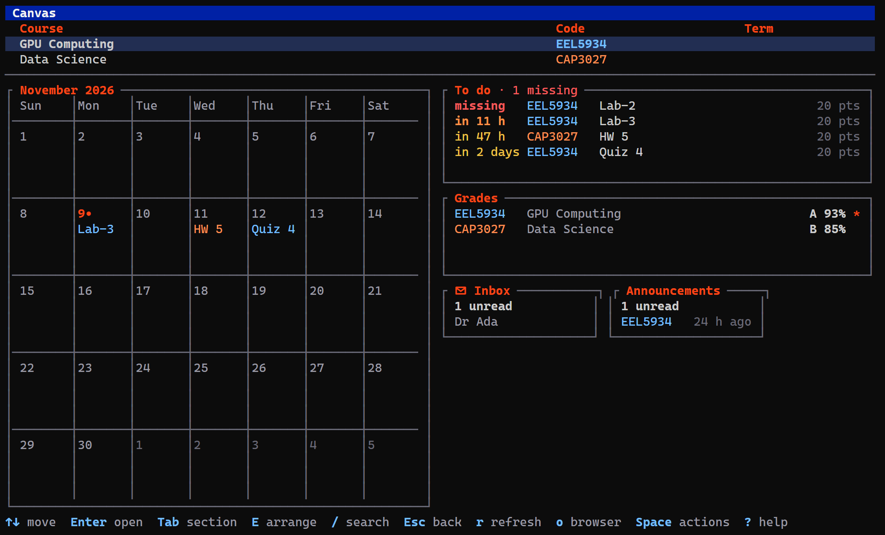
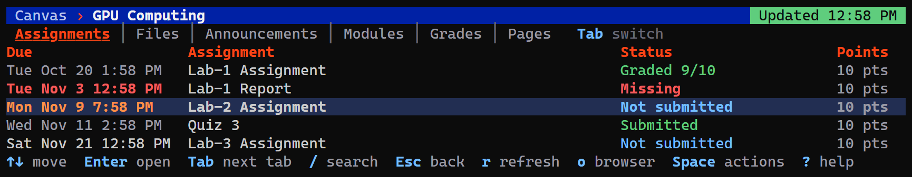
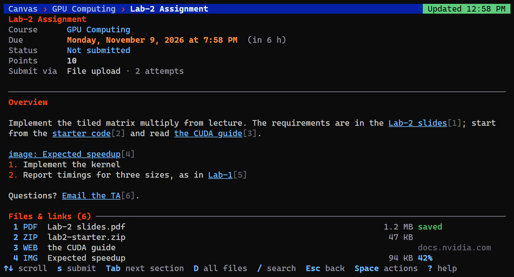
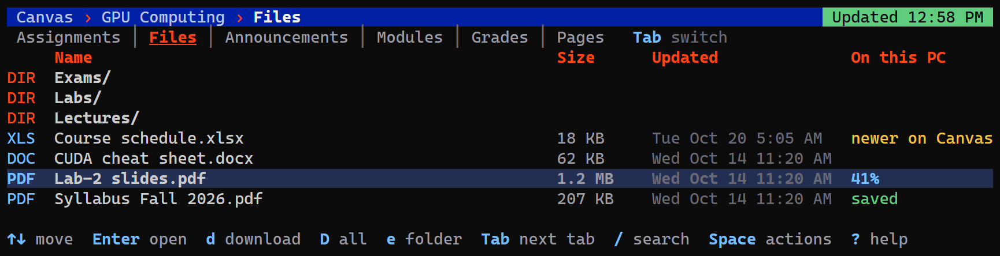

# Screenshots

**Home.** Your courses, with a calendar, to-do list, grades, inbox and announcements underneath. 

**Assignments.** Every assignment in a course, with its due date, status and points.

**An assignment.** Details, the description, and its files and links, numbered so a key opens each one.

**Files.** A course's folders and files, and whether each one is already on your computer.

[← Back to the README](../README.md)
